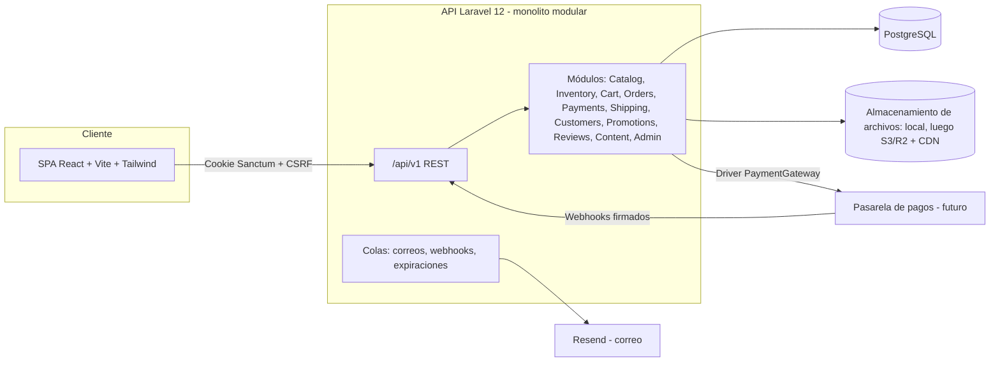
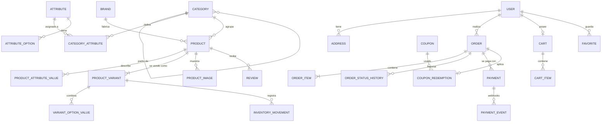
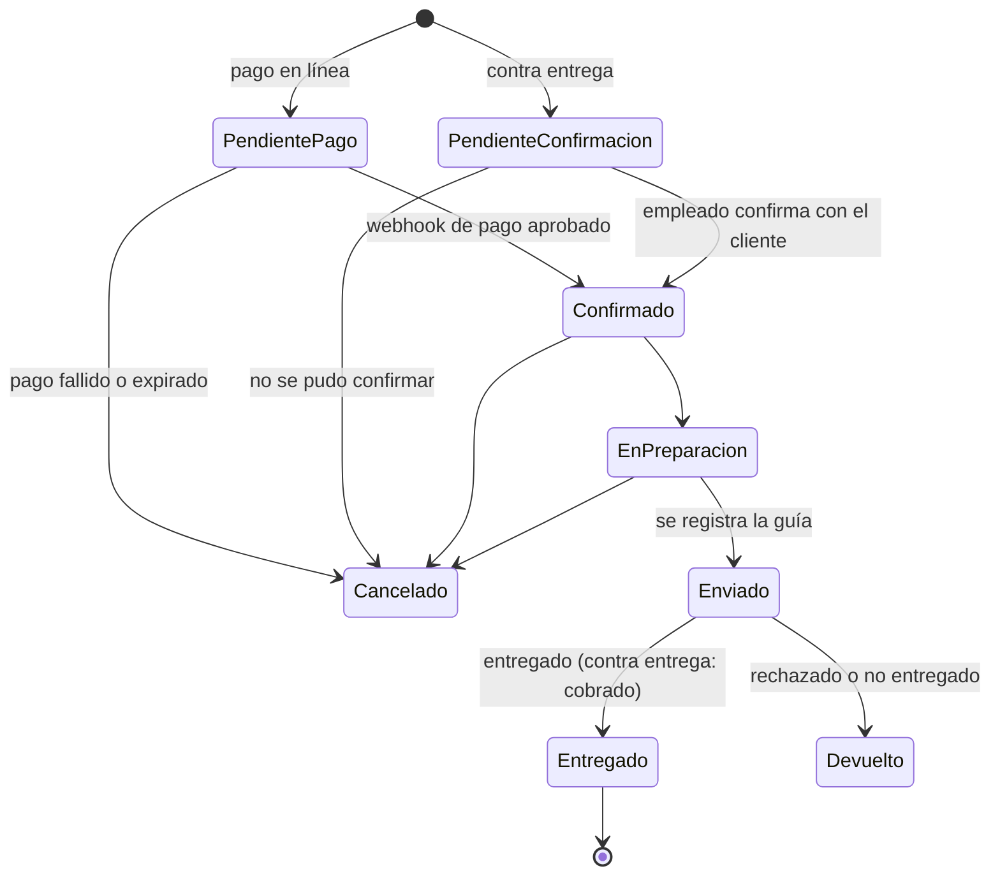
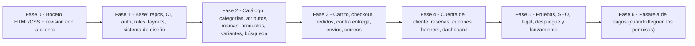

# Plan de implementación: JEMA Market, tienda virtual de suplementos deportivos

> [!IMPORTANT]
> Este documento lo va a leer **otro modelo o desarrollador que va a construir el proyecto**. Tiene dos partes:
> - **Parte A, el boceto (Fase 0):** es lo que se construye ahora. Son páginas HTML y CSS 100% estáticas, sin JavaScript.
> - **Parte B, el sistema real (Fases 1 a 6):** la arquitectura, el modelo de datos, los roles, los pagos y la hoja de ruta. Sirve para que el boceto ya salga pensado para lo que viene después.
>
> En la sección 1 están las decisiones que confirmó el usuario y las que se proponen. Las preguntas que quedan abiertas están en la sección 12.


---

## 1. Contexto y decisiones

| Tema | Decisión | Origen |
|---|---|---|
| Cliente / marca | **JEMA Market S.A.S.** (sale del logo) | Logo entregado |
| País / moneda | **Colombia, COP**. Formato `es-CO`: `$189.900` | Confirmado |
| Catálogo inicial | Solo suplementos deportivos. La arquitectura debe permitir **nuevas categorías con atributos propios** sin tocar código | Requisito |
| Roles | **Admin** (todo), **Empleado** (permisos limitados), **Cliente** (compra) | Requisito |
| Pagos | **Contra entrega** desde el lanzamiento. **Pasarela en línea** todavía sin proveedor (faltan permisos), así que la arquitectura debe permitir conectar cualquiera (Wompi, ePayco, Mercado Pago, PayU…) | Confirmado |
| Contra entrega | La cobertura aún no está definida, por eso **todo es configurable**: zonas, recargo, montos mínimo y máximo | Confirmado |
| Boceto | **Solo HTML y CSS, 100% estático, sin JS** | Confirmado |
| Diseño | **Inspirado** en `Frontend_EcoRisaralda`: mismo estilo general, adaptado a e-commerce | Confirmado |
| Paleta | **Sacada del logo**. Reemplaza el verde esmeralda del repo de referencia | Confirmado |
| Stack final | El usuario dejó la recomendación abierta. **Se propone Laravel 12 + React (sección 8)** | Propuesta |
| Pantallas del boceto, funciones del MVP y permisos del empleado | El usuario los delegó. **Se proponen en las secciones 5, 9 y 10**; hay que validarlos con la clienta | Propuesta |

### Repositorio de referencia (ya clonado en local)
- Frontend: `C:\Users\USUARIO\.gemini\antigravity\brain\5b400767-a1b4-458e-86a3-08bdd899a3fa\scratch\eco\` (React 18 + Vite + Tailwind 3)
- Backend: `...\scratch\ecoback\` (Laravel 12 + Sanctum + Resend + Pest), descargado solo a nivel de metadatos
- Archivos clave para estudiar el estilo: `src/index.css`, `src/components/Header.jsx`, `src/components/Footer.jsx`, `src/HomePage.jsx`, `src/LoginPage.jsx`, `src/AdminDashboardPage.jsx`, `src/components/SitioCard.jsx`, `src/ColeccionPage.jsx`

### Logo
- Original (captura de pantalla de un celular): `...\5b400767-a1b4-458e-86a3-08bdd899a3fa\.user_uploaded\media_1793207671319_f23ae1e3.jpg`
- **Versión ya recortada para usar (512×512 PNG, fondo blanco):** `C:\Users\USUARIO\.gemini\antigravity\brain\5b400767-a1b4-458e-86a3-08bdd899a3fa\logo-jema.png`

> [!WARNING]
> El logo viene de una captura de WhatsApp y tiene baja resolución. Sirve para el boceto, pero para producción hay que pedirle a la clienta un **SVG o un PNG de alta resolución** (sección 12).

---

## 2. Sistema de diseño

### 2.1 Paleta sacada del logo
Los colores se tomaron midiendo píxeles del logo:

| Token | Hex | Uso | Fuente |
|---|---|---|---|
| `--brand-navy` | `#0A3A6A` | Títulos, precios, texto de marca | Letras "JEMA" |
| `--brand-blue-deep` | `#063E80` | Inicio del degradado de marca | Aro, lado izquierdo |
| `--brand-blue` | `#0A8BE5` | Parte media del degradado, íconos y detalles | Aro, parte inferior |
| `--brand-cyan` | `#17BFF5` | Detalles de acento, puntos, badges y anillo de foco | Aro, lado derecho |
| `--brand-cyan-soft` | `#22B8E2` | Íconos secundarios | Caja del logo |
| `--brand-gray` | `#6B6B6B` | Texto secundario de marca | "MARKET S.A.S." |

**Escala `primary`.** Reemplaza al `emerald` de la referencia:

```css
--primary-50:#EAF6FE; --primary-100:#D3EDFD; --primary-200:#A8DBFA; --primary-300:#6FC6F7;
--primary-400:#2FB3F2; --primary-500:#0A8BE5; --primary-600:#0870C8; --primary-700:#0B5AA6;
--primary-800:#0A3A6A; --primary-900:#072A52; --primary-950:#041A33;
--brand-gradient: linear-gradient(135deg,#063E80 0%,#0A8BE5 55%,#17BFF5 100%);
```
- Neutros: igual que la referencia, la escala **slate** de Tailwind (`#0F172A` texto principal, `#334155`, `#475569` texto secundario, `#E2E8F0` bordes, `#F8FAFC` fondo).
- Colores de estado: éxito `#059669`, advertencia `#D97706`, error `#E11D48`, información = primary.

> [!IMPORTANT]
> **Accesibilidad:** el texto blanco sobre `#0A8BE5` solo alcanza un contraste de 3,6:1, que **no cumple AA**. Por eso los botones principales usan **`--primary-600` (#0870C8, contraste 5,05:1)** y `--primary-700` en hover. El cian (`#17BFF5`) se usa solo como acento, nunca como fondo de texto blanco.

### 2.2 Equivalencias con el repositorio de referencia
| En EcoRisaralda | En JEMA Market |
|---|---|
| `emerald-500/600` (botones) | `primary-600/700` |
| `emerald-950/90` (header oscuro) | `primary-950` al 92 % + `backdrop-filter: blur(8px)` |
| `emerald-100` (bordes de cards) | `primary-100` |
| `emerald-50/30` (fondo de cards de beneficios) | `primary-50` al 40 % |
| `emerald-700` (eyebrows) | `primary-700` |
| Login con degradado `#0b2f2a → #0f3f38` | `#041A33 → #0A2A52 → #041A33` con un brillo radial cian suave |
| Patrón de puntos de `coleccion-hero` | Igual, con puntos `rgba(10,139,229,.08)` |

### 2.3 Tipografía, espaciado y forma (igual que la referencia)
- Fuente: **Albert Sans** (400/500/600/700) con respaldo en Space Grotesk y `system-ui`. Se carga desde Google Fonts, igual que en `index.css` de la referencia.
- Contenedor: `max-width: 1280px`, padding horizontal de 16 px (24 px desde 768 px). Equivale a `.page-container`.
- Header: **56 px** de alto (`h-14`), fijo.
- Radios: cards de **8 px** (`rounded-lg`), dropdowns y cajas de íconos de **12 px** (`rounded-xl`), **botones y filtros en píldora** (`999px`).
- Escala de títulos: h1 `2.25rem` → `3rem` desde md (bold); h2 `1.875rem` (semibold); eyebrow `0.875rem` en mayúsculas con `letter-spacing: .25em` y color `primary-700`.
- Sombras: card `0 1px 2px rgba(11,90,166,.08)`, card en hover `0 16px 32px rgba(0,0,0,.10)`, CTA `0 10px 25px rgba(8,112,200,.30)`.
- Animaciones (copiadas de `index.css` de la referencia): `pageFadeIn 320ms`, `dropdownIn 140ms`, transiciones de `200ms cubic-bezier(.2,0,0,1)`, hover de cards con `translateY(-4px)`, zoom de imagen `scale(1.05)`. Todo respeta `prefers-reduced-motion`.
- Breakpoints (los mismos de Tailwind): 640 / 768 / 1024 / 1280.

### 2.4 Componentes base y su versión en la referencia
| Componente | Especificación | Referencia |
|---|---|---|
| `.btn--primary` | Píldora, `primary-600`, texto blanco semibold, `px 24 / py 12`, sombra CTA; en hover sube 2 px y pasa a `primary-700` | Botón "Explorar colección" de `HomePage.jsx` |
| `.btn--outline` | Píldora, borde `primary-300`, texto `slate-900`, hover con fondo `primary-50` | "Crear cuenta ahora" |
| `.btn--ghost-dark` | Píldora, `bg white/10`, `ring white/10`, texto `primary-100` (para el header oscuro) | "Iniciar sesión" de `Header.jsx` |
| `.badge-pill` | Píldora `primary-50` con texto `primary-700` y un punto cian de 8 px | Badge del hero ("Ecoturismo") |
| `.card` | Blanca, borde `primary-100`, radio de 8 px, sombra suave | `SitioCard.jsx` |
| `.card-product` | Ver sección 4.3 | Adaptación de `SitioCard` |
| `.dropdown` | `<details>`, panel blanco con radio de 12 px, `shadow-lg`, `ring slate-200/60`; ítems con hover en `slate-100` y texto primary | Dropdown de usuario de `Header.jsx` |
| `.input` (claro) | Radio de 8 px, borde `slate-300`, foco con `ring 2px primary-400/60` | Formularios de admin |
| `.input--dark` | `bg white/10`, borde `white/10`, texto blanco, placeholder `primary-100/60` | `LoginPage.jsx` |
| `.select-pill` | Píldora blanca, `ring 1px primary-200` | `site-filter-select` |
| `.stat-card` | Borde `slate-100`, radio de 8 px, ícono dentro de un círculo de color `*-100` con padding de 12 px, número de 1.875rem en bold | `AdminDashboardPage.jsx` |
| `.action-card` | Ícono en círculo y flecha que se mueve 4 px a la derecha en hover | Acciones rápidas del dashboard |
| `.alert` (éxito/error/info) | Caja de radio 8 px con borde y fondo suave | `components/Alert.jsx` |
| `.pagination` | Botones redondos y página activa en `primary-600` | `components/Pagination.jsx` |
| `.back-to-top` | Botón redondo fijo abajo a la derecha, `primary-600`, sombra de color (es un enlace a `#top`) | Botón "↑" del home |

### 2.5 Badges de estado de pedido (los mismos colores en el boceto y en el sistema)
| Estado | Clase | Colores |
|---|---|---|
| Pendiente de confirmación (contra entrega) | `.status--pending-confirmation` | amber-100 / amber-800 |
| Pendiente de pago (en línea) | `.status--pending-payment` | yellow-100 / yellow-800 |
| Confirmado | `.status--confirmed` | primary-100 / primary-800 |
| En preparación | `.status--preparing` | violet-100 / violet-800 |
| Enviado | `.status--shipped` | cyan-100 / cyan-800 |
| Entregado | `.status--delivered` | emerald-100 / emerald-800 |
| Cancelado | `.status--cancelled` | rose-100 / rose-800 |
| Devuelto | `.status--returned` | slate-200 / slate-700 |

---

## 3. Boceto: reglas técnicas obligatorias

1. **Cero JavaScript.** No puede haber ninguna etiqueta `<script>`, ningún atributo `onclick`/`on*` ni librerías JS. La interactividad se resuelve **solo con CSS**:
   | Necesidad | Técnica sin JS |
   |---|---|
   | Menú móvil y sidebar del admin en móvil | Truco del checkbox: `<input type="checkbox" id="nav-toggle" hidden>` + `<label for>` + `#nav-toggle:checked ~ .mobile-menu` |
   | Dropdowns (cuenta, ordenar) y filtros en móvil | `<details>/<summary>` con la animación `dropdownIn` |
   | Pestañas (detalle de producto, configuración) | Radios ocultos + `:checked ~ .tab-panels > .panel-n` |
   | Galería de producto | Radios + `<label>` sobre las miniaturas |
   | Acordeón de FAQ | `<details>` |
   | Carruseles | `overflow-x: auto` + `scroll-snap-type: x mandatory` + `.scrollbar-none` |
   | Modales (por ejemplo, "Cancelar pedido") | `:target` (`<a href="#modal-cancelar">`) |
   | Barras de progreso y gráficos | `style="--value:62%"` inline (CSS puro) |
   | Header que cambia al hacer scroll | Opcional, solo como mejora progresiva (ver 4.1) |
2. **Navegación real entre páginas:** todos los enlaces y botones de formulario llevan a una página existente. Los formularios usan `action="pagina.html" method="get"`. Ejemplos: login → `cuenta/perfil.html`, checkout → `confirmacion.html`.
3. **Un solo CSS compartido**, separado por capas: `tokens.css` → `base.css` → `layout.css` → `components.css` → archivos por área (`store.css`, `auth.css`, `account.css`, `admin.css`). No se usa CSS inline, salvo variables `--value` puntuales.
4. **Los nombres de clase deben anticipar los componentes de React** (estilo BEM): `.card-product`, `.card-product__price`, `.btn--primary`, `.status--shipped`. Así la migración a React y Tailwind en la Fase 1 es directa.
5. **Las imágenes son locales:** `assets/img/`. Las fotos de producto son **SVG de relleno** (tarros y frascos con los colores de marca, cada uno con su etiqueta) que se reemplazarán por fotos reales. La única dependencia externa es Google Fonts, y debe tener respaldo.
6. **Accesibilidad:** `lang="es-CO"`, HTML semántico (`header`, `nav`, `main`, `footer`, `article`), `<label>` en todos los campos, `alt` descriptivos, enlace "Saltar al contenido", foco visible (`outline: 3px solid var(--brand-cyan)`) y contraste AA.
7. **Datos de ejemplo realistas para Colombia:** precios en COP, departamentos y municipios reales, celulares `+57 3xx`, nombres de personas colombianos. Las marcas son **ficticias** (IronCore, NutriMax, ProVital, Titan Labs, Andes Nutrition) hasta que la clienta diga cuáles vende.
8. Todo texto legal, cifra de envío o política que no esté confirmada lleva la marca visible **`[Por definir]`** o **`[Validar con asesor legal]`**.

### 3.1 Estructura de carpetas del boceto
Ubicación propuesta (no hay un workspace activo): `C:\Users\USUARIO\.gemini\antigravity\scratch\jema-market\mockup\`

```
mockup/
├─ index.html  catalogo.html  producto.html  carrito.html  carrito-vacio.html
├─ checkout.html  confirmacion.html
├─ login.html  registro.html  recuperar-contrasena.html
├─ nosotros.html  contacto.html  faq.html  terminos.html  privacidad.html
├─ envios-devoluciones.html  404.html  guia-estilos.html
├─ cuenta/   perfil.html  pedidos.html  pedido-detalle.html  direcciones.html  favoritos.html
├─ admin/    index.html  productos.html  producto-editar.html  categorias.html  pedidos.html
│            pedido-detalle.html  clientes.html  usuarios.html  cupones.html  resenas.html
│            configuracion.html
├─ empleado/ index.html  pedidos.html  productos.html
└─ assets/
   ├─ css/  tokens.css base.css layout.css components.css store.css auth.css account.css admin.css
   └─ img/  logo-jema.png  hero/  productos/*.svg  categorias/*.svg  icons/*.svg
```
Primer paso: copiar `logo-jema.png` desde el directorio de artefactos a `assets/img/`. Los íconos son SVG de línea con `stroke-width: 2`, en el mismo estilo de los que usa la referencia (Heroicons outline).

---

## 4. Boceto: componentes globales

### 4.1 Header de la tienda (adaptado de `Header.jsx`)
- **Barra de anuncio** (arriba, 32 px, `primary-900`, texto xs blanco, punto cian): "Pago contra entrega disponible · Envíos a toda Colombia `[Por definir]`".
- **Header principal** fijo, 56 px, fondo `primary-950` al 92 % con desenfoque y una línea inferior `white/10`:
  - Izquierda: el logo dentro de un círculo blanco de 36 px y, al lado, el texto en dos líneas "**JEMA**" (bold) / "MARKET" (light), igual que "Conexion / EcoRisaralda" en la referencia.
  - Centro (desde lg): **buscador** en píldora (`bg white/10`, `ring white/15`, ícono de lupa). Es un formulario `action="catalogo.html"`.
  - Derecha: favoritos (ícono), **carrito con un badge cian que muestra "3"**, y la cuenta. En las páginas de visitante van los botones "Iniciar sesión" (ghost) y "Crear cuenta" (primary). En las páginas con sesión iniciada va una píldora con avatar e inicial + `<details>` desplegable con: Mi perfil, Mis pedidos, Favoritos, Direcciones, Cerrar sesión.
- **Fila de categorías** (desde xl, 44 px, `primary-900`): Proteínas · Creatinas · Pre-entrenos · Aminoácidos · Ganadores de peso · Quemadores · Vitaminas y bienestar · **Ofertas** (en cian). El enlace activo va en `--brand-cyan`, igual que el activo `emerald-500` de la referencia.
- **Móvil:** hamburguesa animada de 2 líneas que forma una X (la misma de la referencia) y abre un **panel de pantalla completa** `white/80` con desenfoque. Los enlaces van en `text-3xl` bold y aparecen escalonados con `transition-delay` según `nth-child`. Todo con el truco del checkbox.
- **Mejora progresiva opcional en `index.html`:** dentro de `@supports (animation-timeline: scroll())`, hacer que el header pase del navy translúcido a blanco con desenfoque (registrando `--header-fg` con `@property` como `<color>`). Si el navegador no lo soporta, el header se queda navy.

### 4.2 Footer (adaptado de `Footer.jsx`)
Fondo `primary-50` al 50 % y borde superior `primary-100`. Cuatro columnas (en móvil, una sola y centrada):
1. Logo + "JEMA Market" + una descripción corta + íconos de redes `[Por definir]`.
2. **Tienda:** las categorías y Ofertas.
3. **Ayuda:** FAQ, Envíos y devoluciones, Términos y condiciones, Política de privacidad, Mi cuenta.
4. **Contacto:** correo, celular/WhatsApp, ciudad `[Por definir]`, horario de atención.
Franja inferior: frase de marca en cursiva, "© 2026 JEMA Market S.A.S. · NIT `[Por definir]` · Todos los derechos reservados", fichas de medios de pago ("Contra entrega", "Pago en línea: próximamente") y un enlace a la SIC `[Validar]`.

### 4.3 Card de producto (`.card-product`, adaptada de `SitioCard.jsx`)
- Contenedor: `article.card` con hover (sombra grande y zoom de imagen a 1.05).
- Imagen: cuadrada (`aspect-ratio: 1`), fondo `#F4F8FC`, `object-fit: contain`.
- **Badges** arriba a la izquierda: "-15 %" (rose), "Nuevo" (primary), "Agotado" (slate). Arriba a la derecha, el **botón de favorito** redondo de 40 px (corazón, con la misma forma del botón de favoritos de la referencia).
- Cuerpo con padding de 16 px: marca (xs, mayúsculas, `slate-500`), nombre (semibold, máximo 2 líneas), estrellas + número de reseñas, **precio** (bold, `--brand-navy`) + precio anterior tachado, y el texto "3 sabores · 2 tamaños".
- Botón "Agregar" en píldora de ancho completo, `primary-600`. Si está agotado: deshabilitado, con el texto "Agotado" y la imagen al 60 % de opacidad. Si queda poco stock: texto amber "¡Quedan 3!".

### 4.4 Otros componentes globales
- **WhatsApp** flotante abajo a la derecha (verde `#25D366`, 56 px) y el back-to-top encima.
- **Breadcrumb** en catálogo, producto y páginas de cuenta.
- **Estados vacíos** con ilustración SVG, título y CTA (carrito vacío, sin pedidos, sin favoritos, sin resultados).
- **Skeleton** (solo se muestra en `guia-estilos.html` como referencia para la versión en React).

---

## 5. Boceto: pantallas (propuesta)

Prioridad: **P1** = imprescindible para presentarle a la clienta. **P2** = completa la visión y puede ir en una segunda ronda.

### 5.1 Tienda pública
| Página | Pri. | Contenido |
|---|---|---|
| `index.html` | P1 | 1) Hero al estilo de la referencia: imagen o composición de marca con un velo blanco a la izquierda (`linear-gradient(to right, #fff, rgba(255,255,255,.6), rgba(0,0,0,.2))`), badge-pill "Suplementos deportivos", h1 "Potencia tu rendimiento con suplementos originales", párrafo, CTA "Ver catálogo" (primary) y "Ver ofertas" (outline), y **2 tarjetas flotantes de vidrio** abajo a la derecha ("Pago contra entrega" y "Envíos a todo el país") con `bg white/15 + blur`, igual que las de "Próximo evento". 2) Franja de 4 beneficios en texto (Productos originales con registro INVIMA · Contra entrega · Envíos nacionales · Asesoría por WhatsApp). 3) **Compra por categoría**: mosaicos con imagen y un degradado inferior oscuro (estilo `coleccion-reco-card`). 4) **Compra por objetivo**: fichas grandes (Ganar masa muscular, Definición, Energía y rendimiento, Recuperación, Salud y bienestar). 5) **Más vendidos**: carrusel con scroll-snap de cards de producto. 6) **Banner promocional** grande (`min-height: 24rem`, radio de 8 px, `--brand-gradient` + imagen; es la adaptación del carrusel de eventos). 7) **Novedades**: grilla de 4 columnas. 8) Franja de **marcas** en escala de grises. 9) **Por qué comprar en JEMA Market**: 3 cards de beneficios (copia de las cards "Beneficios" de la referencia). 10) **Reseñas de clientes**: 3 testimonios. 11) Bloque CTA "Crea tu cuenta y recibe ofertas exclusivas". 12) Footer |
| `catalogo.html` | P1 | Hero compacto con el patrón de puntos (`coleccion-hero`) + breadcrumb + título "Proteínas" + "48 productos". Sidebar de filtros (desde lg): categoría con contadores, marca, objetivo, rango de precio (mínimo y máximo), sabor, "Solo disponibles", "En oferta". En móvil, los filtros van dentro de un `<details>`. Barra superior con fichas de filtros activos (con ×) + select de orden en píldora (Relevancia, Más vendidos, Precio ↑, Precio ↓, Novedades). Grilla de 2, 3 o 4 columnas según el ancho, con al menos 12 cards que incluyan una agotada, una en oferta y una nueva. Paginación |
| `producto.html` | P1 | Breadcrumb. **Galería** (radios + miniaturas). Columna de información: marca, h1, estrellas con enlace a las reseñas, precio + precio anterior + badge de descuento, "IVA incluido `[Validar]`", **selectores de variante en píldoras** (Sabor: Chocolate/Vainilla/Fresa · Tamaño: 2 lb/5 lb, con una opción agotada tachada), indicador de stock, cantidad (`input type=number`), "Agregar al carrito" grande + favorito, fichas de confianza (Contra entrega disponible · Envío 2–5 días hábiles `[Por definir]` · Producto original), "Registro sanitario INVIMA: RSA-XXXXXX `[Por definir]`". **Pestañas** (radios): Descripción · Información nutricional (tabla) · Modo de uso · Advertencias (con la leyenda legal `[Validar]`: "Este producto no es un medicamento…") · Reseñas (resumen con barras 5★–1★, lista y la nota "Solo compradores verificados pueden opinar"). Carrusel de "También te puede interesar" |
| `carrito.html` | P1 | Lista de ítems (imagen, nombre, variante, precio unitario, cantidad, total de la línea, "Eliminar"). **Barra de progreso hacia el envío gratis** ("Te faltan $38.000…" `[Por definir]`). Resumen fijo al lado: subtotal, descuento, envío ("Se calcula en el checkout"), total, campo de cupón y botón "Finalizar compra". Enlace "Seguir comprando" |
| `carrito-vacio.html` | P2 | Estado vacío con CTA al catálogo y una fila de más vendidos |
| `checkout.html` | P1 | **Header simplificado** (logo + candado "Compra segura" + "Volver al carrito"). Stepper visual de 3 pasos (Datos · Envío · Pago) presentados como 3 tarjetas en una sola página. Aviso "¿Ya tienes cuenta? Inicia sesión". **Datos:** nombre, apellido, correo, celular, tipo y número de documento. **Envío:** dirección guardada (radio) o una nueva: departamento, municipio, dirección, barrio, indicaciones; luego el método de envío (radio con precio y tiempo `[Por definir]`). **Pago (radio-cards):** ① **Pago contra entrega**, seleccionado, con la descripción "Pagas al recibir tu pedido" y el badge "Disponible en tu ciudad". ② **Pago en línea (tarjeta, PSE, Nequi)**, deshabilitado con el badge "Próximamente". Notas del pedido. Checkboxes obligatorios: términos y condiciones, y **autorización de tratamiento de datos (Ley 1581 de 2012)**. Botón "Confirmar pedido" que lleva a `confirmacion.html`. Resumen del pedido al lado |
| `confirmacion.html` | P1 | Ícono de éxito, "¡Gracias por tu compra!", **pedido JM-000123**, badge "Pendiente de confirmación", el mensaje "Te contactaremos por WhatsApp o llamada para confirmar tu pedido contra entrega", una línea de tiempo con los próximos pasos, el resumen y la dirección, y los botones "Ver mi pedido" y "Seguir comprando" |
| `login.html` / `registro.html` / `recuperar-contrasena.html` | P1 | **Copia del diseño de `LoginPage.jsx`**: fondo con degradado navy en toda la pantalla y un brillo cian radial. A la izquierda (desde md): logo, eyebrow "SUPLEMENTOS DEPORTIVOS" (`tracking .4em`, cian al 80 %), h1 y párrafo. A la derecha, una card de vidrio de 420 px (`bg white/10`, `ring white/10`, blur, padding de 32 px) con los inputs oscuros, "Mostrar" contraseña, "¿Olvidaste tu contraseña?", el botón de ancho completo y el enlace para cambiar entre login y registro. Registro: nombre, apellido, correo, celular, contraseña + confirmación, términos y habeas data. Se muestra un **ejemplo de error de validación** en un campo |
| `nosotros.html` | P2 | Hero, historia, misión y visión, valores en cards |
| `contacto.html` | P2 | Formulario + WhatsApp + correo + horario + un recuadro de mapa (imagen estática) |
| `faq.html` | P1 | Acordeones `<details>` agrupados en Pedidos, Pagos y contra entrega, Envíos, Productos, Devoluciones |
| `terminos.html` / `privacidad.html` / `envios-devoluciones.html` | P2 | Plantilla legal: índice lateral fijo + contenido. Incluye los apartados de **derecho de retracto y reversión del pago (Ley 1480 de 2011)** y **habeas data (Ley 1581 de 2012)**, todos marcados `[Validar con asesor legal]` |
| `404.html` | P2 | Página no encontrada con buscador y CTA |
| `guia-estilos.html` | P1 | **Guía de estilos visual:** paleta, tipografía, botones, inputs claros y oscuros, badges de estado, cards, alerts, paginación, skeleton y estados vacíos. Le sirve a la clienta para aprobar y al equipo como referencia |

### 5.2 Área del cliente (`cuenta/`)
Layout: header de la tienda + contenido con un **menú lateral** (card de 240 px con Perfil, Mis pedidos, Direcciones, Favoritos, Cerrar sesión; el ítem activo va en `primary-50` con texto `primary-700`). En móvil, el menú pasa a ser una fila horizontal desplazable.

| Página | Pri. | Contenido |
|---|---|---|
| `perfil.html` | P1 | "Hola, Laura", como el saludo de la referencia. Mini estadísticas (pedidos y favoritos), formulario de datos personales y una sección para cambiar la contraseña |
| `pedidos.html` | P1 | Filtro por estado (fichas), y cada pedido como card: número, fecha, badge de estado, miniaturas de los productos, total, "Ver detalle". Debe mostrar varios estados distintos |
| `pedido-detalle.html` | P1 | **Línea de tiempo vertical** (Recibido → Confirmado → En preparación → Enviado → Entregado) con el paso actual resaltado, transportadora y número de guía `[Por definir]`, ítems, totales, dirección, método de pago. Botones "Cancelar pedido" (solo si está pendiente, con un modal `:target`), "Volver a comprar" y "Calificar productos" |
| `direcciones.html` | P2 | Cards de direcciones con un badge "Predeterminada" y un formulario para agregar dentro de un `<details>` |
| `favoritos.html` | P2 | Grilla de cards con la opción de quitar |

### 5.3 Back-office (`admin/` y `empleado/`)
**Layout distinto al de la tienda** (es la parte "inspirada"): un sidebar de 260 px blanco con borde `slate-100`, el logo y la etiqueta de rol debajo (**ADMINISTRADOR** / **EMPLEADO**, como `roleLabel` en la referencia), ítems con ícono y el activo en `primary-50`/`primary-700`. Barra superior blanca de 56 px con buscador, notificaciones y una píldora de usuario. Fondo del contenido `slate-50`. En móvil, el sidebar se abre con el truco del checkbox. Las tablas son blancas, con radio de 8 px, borde `slate-100`, encabezado `slate-50` en xs mayúsculas `slate-500`, y filas con hover.

| Página | Pri. | Contenido |
|---|---|---|
| `admin/index.html` | P1 | Título "Panel de administración", fichas de periodo (Hoy, 7 días, 30 días). **4 stat-cards** (Ventas del mes, Pedidos nuevos, Contra entrega por confirmar, Productos con stock bajo), cada una con su ícono en un círculo de color, como en la referencia. **Gráfico de barras CSS** "Ventas de los últimos 7 días". Tabla de pedidos recientes. Lista de stock bajo. Grilla de **acciones rápidas** (`.action-card`) |
| `admin/productos.html` | P1 | Barra de herramientas: búsqueda, filtros (categoría, marca, estado) y "Nuevo producto". Tabla: checkbox, imagen, nombre + SKU, categoría, marca, precio, stock (con badge si está bajo), número de variantes, estado (Activo, Borrador, Archivado) y acciones (editar, duplicar, eliminar). Acciones masivas. Paginación |
| `admin/producto-editar.html` | P1 | Dos columnas. **Izquierda:** información general; imágenes (zona para soltar archivos + miniaturas); **"Atributos de la categoría: Suplementos › Proteínas"** (registro INVIMA, tabla nutricional, modo de uso, advertencias, objetivo), con una nota que explica que **estos campos los define cada categoría** (así se ve la escalabilidad); **variantes** (ejes Sabor y Tamaño como fichas, y una tabla con SKU, variante, precio, precio anterior, stock, activo). **Derecha:** estado y visibilidad, organización (categoría, marca, destacado) y SEO. Barra fija con "Guardar" y "Cancelar" |
| `admin/categorias.html` | P1 | Árbol de categorías (Suplementos › Proteínas, Creatinas…) con íconos para arrastrar y su estado. Panel "Editar categoría" con **atributos asignados** (checkbox y "obligatorio"). Debajo, una tabla de **Atributos** (nombre, tipo, si es filtrable, si es eje de variante). Debe incluir una categoría de ejemplo **desactivada, "Ropa deportiva (próximamente)"**, con los atributos Talla y Color, para mostrarle a la clienta cómo se crecerá |
| `admin/pedidos.html` | P1 | Pestañas por estado con contadores. Filtros (fecha, método de pago, ciudad). Tabla: número, fecha, cliente, ciudad, método de pago, total, estado del pago, estado del pedido, ver |
| `admin/pedido-detalle.html` | P1 | Número, badges y **acciones de estado** (Confirmar pedido, Marcar en preparación, Marcar como enviado con campo de guía, Marcar entregado y cobrado, Cancelar con motivo). Cards de cliente, dirección y pago (método, estado, referencia). Tabla de ítems y totales. **Historial de estados** (quién, cuándo, nota). Notas internas |
| `admin/clientes.html` | P2 | Tabla: nombre, correo, celular, ciudad, pedidos, total gastado, fecha de registro, estado |
| `admin/usuarios.html` | P1 | Pestaña **Equipo** (admins y empleados, botón "Nuevo empleado", activar o desactivar). Pestaña **Roles y permisos**: **matriz de permisos** por módulo con columnas Admin (bloqueada, todos los permisos) y Empleado (ver sección 10) |
| `admin/cupones.html` | P2 | Tabla + formulario (código, tipo, valor, compra mínima, vigencia, límite de usos) |
| `admin/resenas.html` | P2 | Lista para moderar: estrellas, producto, cliente, badge "Compra verificada", aprobar o rechazar |
| `admin/configuracion.html` | P1 | Pestañas: **Tienda** (nombre, NIT, contacto, WhatsApp, redes). **Pagos:** contra entrega (activar/desactivar, **cobertura** por departamentos y ciudades, recargo, monto mínimo y máximo, instrucciones al cliente) y **pasarela en línea** (card "Pendiente de habilitación", select de proveedor deshabilitado, texto explicativo). **Envíos** (zonas, tarifas y "envío gratis desde"). **Banners del home**. **Notificaciones** (correos que se envían) |
| `empleado/index.html` | P1 | Mismo layout con la etiqueta EMPLEADO y el **sidebar reducido** (Inicio, Pedidos, Productos, Clientes, Reseñas). Solo indicadores operativos (por confirmar, por preparar, por enviar, stock bajo), **sin cifras de ventas** |
| `empleado/pedidos.html` / `empleado/productos.html` | P1 | Iguales a los del admin, pero **sin eliminar** y sin acceso a configuración ni usuarios. En la tabla de productos solo aparecen "Editar" y "Ajustar stock" |

---

## 6. Boceto: criterios de aceptación y verificación

- [ ] `Select-String -Path mockup -Pattern '<script|onclick=|on[a-z]+="' -Recurse` no devuelve ningún resultado.
- [ ] **No hay enlaces rotos.** Comprobarlo con un script local que recorra cada `href` y `action`.
- [ ] Todas las páginas P1 existen y se ven bien a **375, 768, 1024 y 1440 px** (revisar con capturas del navegador).
- [ ] El menú móvil, los dropdowns, las pestañas, la galería, la FAQ y el modal de cancelar funcionan sin JS.
- [ ] El HTML pasa el validador de W3C sin errores.
- [ ] Lighthouse da **Accesibilidad ≥ 90** en el inicio, el producto y el checkout.
- [ ] Los colores salen solo de `tokens.css`; no hay valores hex sueltos en otros CSS, salvo colores de terceros como el verde de WhatsApp.
- [ ] Todos los marcadores `[Por definir]` y `[Validar…]` están visibles y listados en el `README.md` del boceto.
- [ ] El `README.md` del boceto explica cómo abrirlo (con doble clic en `index.html`) y tiene un mapa de páginas.

---

## 7. Parte B: arquitectura del sistema real

### 7.1 Visión general
**Monolito modular** con una API REST y una SPA separada. Es liviano para arrancar y cada módulo tiene límites claros, de modo que se pueda escalar o separar más adelante sin reescribir.



### 7.2 Etapas de escalabilidad (sin reescribir)
| Etapa | Infraestructura |
|---|---|
| Lanzamiento | Un VPS: Nginx + PHP-FPM + PostgreSQL. Colas y caché en `database`. Archivos en disco local |
| Crecimiento | **Redis** para caché, colas y sesiones. Archivos en **S3/Cloudflare R2 + CDN**. Supervisor/Horizon para las colas |
| Catálogo grande | **Meilisearch con Laravel Scout** para búsqueda y filtros. Réplica de lectura de la base de datos |
| Alto tráfico | Varias instancias de la API detrás de un balanceador (la API no guarda estado), base de datos gestionada |

---

## 8. Stack recomendado y por qué

| Capa | Recomendación | Justificación |
|---|---|---|
| Backend | **Laravel 12 (PHP 8.3)** | El equipo ya lo usó en `Backend_EcoRisaralda` (Laravel 12 + Sanctum + Resend + Pest), así que se aprovecha esa experiencia. Ya trae colas, correo, eventos, policies, scheduler y almacenamiento. Las pasarelas colombianas (Wompi, ePayco, Mercado Pago, PayU) tienen SDK o API REST fácil de consumir desde PHP |
| Base de datos | **PostgreSQL 16** (MySQL 8 también sirve) | Transacciones sólidas para stock y pedidos, **JSONB indexable** para atributos por categoría e índices parciales |
| Autenticación | **Laravel Sanctum** (SPA con cookie), verificación de correo | La misma que en la referencia y más segura que guardar tokens en localStorage |
| Roles y permisos | **spatie/laravel-permission** | Roles y permisos granulares que se editan desde la base de datos, sin desplegar código |
| Auditoría | **spatie/laravel-activitylog** | Registra quién cambió precios, stock o estados |
| Frontend | **React 18 + Vite + Tailwind 3 + React Router 6** | Igual que la referencia |
| Estado y datos | **TanStack Query** (datos del servidor), **Zustand** (carrito y estado de UI), **React Hook Form + Zod** (formularios) | Caché, reintentos y formularios robustos sin complicar el código |
| Calidad | Pest + PHPStan/Larastan + Pint · Vitest + Testing Library · ESLint/Prettier · GitHub Actions | La referencia ya usa Pest y Vitest |
| Correo | Resend (ya integrado en la referencia) | — |

> [!NOTE]
> **Riesgo de SEO:** una SPA se posiciona peor en Google que un sitio renderizado en el servidor. Para mitigarlo: `react-helmet-async` para los metadatos, `sitemap.xml` y datos estructurados `Product` generados por la API, y URLs limpias (`/producto/proteina-whey-ironcore`). Si más adelante el SEO se vuelve crítico, se puede preprenderizar el catálogo o migrar el frontend público a SSR sin tocar la API.

### 8.1 Estructura del backend
```
app/
  Domain/
    Catalog/      (Category, Attribute, Brand, Product, ProductVariant, ProductImage)
    Inventory/    (InventoryMovement, StockService)
    Cart/         (Cart, CartItem, CartService)
    Orders/       (Order, OrderItem, OrderStatusHistory, OrderStateMachine, PlaceOrderAction)
    Payments/     (Payment, PaymentManager, Contracts/PaymentGateway, Gateways/CashOnDelivery, Gateways/*)
    Shipping/     (ShippingZone, ShippingRate, ShippingQuoteService)
    Customers/    (Address, Favorite)
    Promotions/   (Coupon, CouponRedemption, CouponValidator)
    Reviews/      (Review)
    Content/      (Banner, Setting, Page)
  Http/Controllers/Api/V1/{Store,Account,Admin}/...  Http/Requests  Http/Resources
  Policies/  Events/  Listeners/  Jobs/  Notifications/
```
Reglas: controladores delgados; la lógica va en **Actions/Services**; la validación en **Form Requests**; la salida en **API Resources**; la autorización con **Policies + permisos**; los efectos secundarios (correos, stock) con **eventos y colas**.

### 8.2 Estructura del frontend
```
src/
  app/ (router, providers, layouts: StoreLayout, CheckoutLayout, AccountLayout, AdminLayout)
  components/ui/ (Button, Input, Select, Badge, Card, Modal, Dropdown, Tabs, Table, Pagination, EmptyState, Skeleton)
  features/ catalog/ product/ cart/ checkout/ auth/ account/ admin/{dashboard,products,categories,orders,customers,users,coupons,reviews,settings}
  lib/ (api axios con withCredentials, formatCOP, queryClient)  hooks/  styles/
```
- Los tokens de `tokens.css` del boceto pasan **tal cual** a `tailwind.config.js` → `theme.extend.colors.primary` y `brand`.
- Las clases BEM del boceto se convierten en componentes (`.card-product` → `<ProductCard/>`).
- Las rutas y menús del back-office se generan a partir de los **permisos del usuario** (`can('orders.view')`), no del nombre del rol.

---

## 9. Modelo de datos

### 9.1 Clave de la escalabilidad: categorías con atributos dinámicos
- **Categorías en árbol** (`parent_id`). Cada categoría tiene **atributos asignados** (`category_attribute`).
- **Atributos tipados** (`text`, `richtext`, `number`, `select`, `multiselect`, `boolean`, `table`) con las banderas `is_filterable` e `is_variant_axis`.
- Para agregar "Ropa deportiva" mañana basta con crear la categoría y asignarle los atributos *Talla* y *Color* (ejes de variante) y *Material*. **No hay que tocar código.** El formulario del admin y los filtros del catálogo se construyen a partir de esa configuración.
- **Todo producto tiene al menos una variante** (si no tiene opciones, una variante por defecto). El carrito, el stock y los pedidos siempre trabajan sobre la **variante**, lo que mantiene la lógica uniforme.
- Datos propios de los suplementos (registro INVIMA, tabla nutricional, modo de uso, advertencias, objetivo) = **atributos de la categoría Suplementos**, no columnas fijas de la tabla de productos.



### 9.2 Tablas principales (campos clave)
| Tabla | Campos |
|---|---|
| `users` | name, last_name, email, phone, document_type, document_number, password, email_verified_at, is_active, data_consent_at, data_consent_version |
| `roles`, `permissions`, `model_has_roles`… | Las de spatie |
| `addresses` | user_id, label, recipient, phone, department_code, city_code (DANE), line1, neighborhood, notes, is_default |
| `departments`, `cities` | Códigos DANE (seed completo de Colombia) |
| `categories` | parent_id, name, slug, description, image, is_active, sort_order |
| `attributes` / `attribute_options` | code, name, type, unit, is_filterable, is_variant_axis / value, sort |
| `category_attribute` | category_id, attribute_id, is_required, sort |
| `brands` | name, slug, logo, is_active |
| `products` | category_id, brand_id, name, slug, short_description, description, status (draft/active/archived), is_featured, meta_title, meta_description, `extra` JSONB |
| `product_attribute_values` | product_id, attribute_id, option_id (nullable), value_text, value_number, value_json |
| `product_variants` | product_id, sku (único), name, **price**, compare_at_price, cost, weight_grams, barcode, stock, reserved, low_stock_threshold, is_active |
| `variant_option_values` | variant_id, attribute_option_id |
| `product_images` | product_id, variant_id (nullable), path, alt, sort |
| `inventory_movements` | variant_id, type (in/out/adjust/reserve/release/sale/return), qty, reason, user_id, order_id |
| `carts` / `cart_items` | user_id o guest_token, expires_at / variant_id, qty |
| `orders` | number (`JM-000123`), user_id, status, payment_status, payment_method, subtotal, discount_total, shipping_total, tax_total, grand_total, currency, coupon_code, customer_snapshot JSONB, shipping_address_snapshot JSONB, shipping_method, tracking_carrier, tracking_number, notes, placed_at, cancelled_at, cancel_reason |
| `order_items` | order_id, variant_id, product_name, variant_name, sku, unit_price, qty, line_total (se guardan **copias de los datos al momento de la compra**) |
| `order_status_history` | order_id, from_status, to_status, user_id, note |
| `payments` | order_id, gateway, amount, status, gateway_reference, payload JSONB, paid_at |
| `payment_events` | payment_id, gateway, event_id (**único, para no procesar dos veces el mismo webhook**), type, payload, processed_at |
| `shipping_zones` / `shipping_rates` | name, cobertura (departamentos y ciudades) / zone_id, name, price, free_over, eta_min_days, eta_max_days |
| `cod_settings` (o `settings`) | enabled, zone_ids, surcharge, min_amount, max_amount, instructions |
| `coupons` / `coupon_redemptions` | code, type (percent/fixed/free_shipping), value, min_subtotal, max_uses, max_uses_per_user, starts_at, ends_at, scope / coupon_id, order_id, user_id |
| `reviews` | product_id, user_id, order_item_id, rating, title, body, status (pending/approved/rejected) |
| `favorites`, `banners`, `settings` (clave → JSON), `activity_log` | — |

**Dinero:** se guarda en **enteros de pesos COP** (`bigint`). Nunca se usan flotantes. **El servidor siempre recalcula precios y totales;** lo que envía el cliente no se toma como válido.

### 9.3 Estados del pedido

- **Stock:** se **reserva** al crear el pedido (`reserved += qty`) y se **descuenta** al confirmarlo o enviarlo. Si el pedido se cancela o expira, la reserva se **libera**. Un job programado libera los pedidos en línea sin pagar después de N minutos (configurable).
- **Contra entrega:** el pago queda `pending` hasta que el empleado marca **"Entregado y cobrado"**; en ese momento pasa a `paid`. Así la conciliación es clara.
- Cada transición: valida que el paso sea permitido (`OrderStateMachine`), guarda el historial, dispara un evento (correo al cliente) y queda en la auditoría.

---

## 10. Roles y permisos (propuesta)

Se usa un modelo basado en **permisos**: los roles son grupos de permisos que el admin puede ajustar desde el panel.

| Permiso | Admin | Empleado | Cliente |
|---|:-:|:-:|:-:|
| `products.view` / `products.create` / `products.update` | ✅ | ✅ | — |
| `products.delete` (archivar o eliminar) | ✅ | ❌ | — |
| `inventory.adjust` (ajustes con motivo) | ✅ | ✅ | — |
| `categories.manage` / `attributes.manage` / `brands.manage` | ✅ | ❌ | — |
| `orders.view` / `orders.update_status` | ✅ | ✅ | — |
| `orders.confirm_cod` (confirmar contra entrega) | ✅ | ✅ | — |
| `orders.cancel` (antes del envío, con motivo obligatorio) | ✅ | ✅ | — |
| `orders.refund` | ✅ | ❌ | — |
| `customers.view` (lectura) | ✅ | ✅ | — |
| `customers.manage` (editar o desactivar) | ✅ | ❌ | — |
| `reviews.moderate` | ✅ | ✅ | — |
| `coupons.manage` / `banners.manage` | ✅ | ❌ | — |
| `reports.sales` (cifras de ventas) | ✅ | ❌ | — |
| `users.manage` / `roles.manage` | ✅ | ❌ | — |
| `settings.manage` / `payments.configure` / `shipping.manage` | ✅ | ❌ | — |
| Recursos propios (perfil, direcciones, pedidos, favoritos, reseñas) | — | — | ✅ (vía Policies) |

**Por qué este reparto:** el empleado puede atender toda la operación del día a día (pedidos, confirmación de contra entrega, catálogo, stock y reseñas), pero no puede tocar dinero (reembolsos, cupones, reportes), estructura (categorías y atributos), seguridad (usuarios y roles) ni configuración. Todas sus acciones quedan auditadas.

---

## 11. Pagos: arquitectura que acepta cualquier pasarela

```php
interface PaymentGateway {
    public function code(): string;                       // 'cod', 'wompi', 'epayco'...
    public function isAvailableFor(Order $order): bool;   // cobertura, montos, estado habilitado
    public function initiate(Order $order): PaymentInitiation; // redirect_url | widget_payload | none
    public function verifyWebhook(Request $request): bool;     // firma/HMAC
    public function parseWebhook(Request $request): WebhookResult; // event_id, reference, status
    public function refund(Payment $payment, int $amount): RefundResult;
}
```
- `PaymentManager`, que extiende `Illuminate\Support\Manager`, resuelve cada driver con la configuración de `config/payments.php` y las credenciales del `.env`. Que un driver esté habilitado o no se decide desde **Configuración → Pagos**.
- **Desde el día 1:** `CashOnDeliveryGateway` (revisa la zona, el monto mínimo y máximo, y suma el recargo).
- **Cuando lleguen los permisos:** se crea `Gateways/{Proveedor}Gateway.php`, se agregan las credenciales y se activa. **El frontend no cambia**, porque el checkout pide los métodos a `GET /api/v1/checkout/payment-methods`.
- **Webhooks:** `POST /api/v1/payments/webhooks/{gateway}`. Se verifica la firma, se guarda el evento en `payment_events` (con `event_id` único para no procesarlo dos veces), se procesa en cola y se responde 200 de inmediato. También hay un job que concilia los pagos pendientes consultando el estado en la pasarela.
- **Nunca** se guardan datos de tarjetas (la pasarela usa su checkout o widget), lo que deja el alcance PCI al mínimo.

### 11.1 Endpoints de la API (v1, resumen)
| Área | Endpoints |
|---|---|
| Autenticación | `POST /auth/register` · `/auth/login` · `/auth/logout` · `/auth/forgot-password` · `/auth/reset-password` · `GET /auth/me` · verificación de correo |
| Catálogo | `GET /categories` (árbol) · `/categories/{slug}/filters` · `/products?category=&brand=&goal=&price_min=&price_max=&attr[sabor]=&in_stock=&sort=&page=` · `/products/{slug}` · `/brands` · `/search?q=` · `/banners` |
| Carrito | `GET/POST/PATCH/DELETE /cart/items` · `POST /cart/coupon` · `POST /cart/merge` (al iniciar sesión se une el carrito de invitado) |
| Checkout | `GET /checkout/shipping-options?city=` · `GET /checkout/payment-methods` · `POST /checkout` (crea el pedido; acepta el header `Idempotency-Key`) |
| Cuenta | `GET/PATCH /account/profile` · `/account/addresses` (CRUD) · `/account/orders` · `/account/orders/{number}` · `POST /account/orders/{number}/cancel` · `/account/favorites` · `POST /products/{id}/reviews` |
| Admin | `/admin/dashboard` · `/admin/products` (CRUD + variantes + imágenes) · `/admin/categories` · `/admin/attributes` · `/admin/brands` · `/admin/inventory/adjust` · `/admin/orders` + `PATCH /admin/orders/{id}/status` · `/admin/customers` · `/admin/users` · `/admin/roles` · `/admin/coupons` · `/admin/reviews` · `/admin/banners` · `/admin/settings` · `/admin/shipping-zones` |
| Pagos | `POST /payments/webhooks/{gateway}` |

### 11.2 Seguridad y cumplimiento
- Sanctum con cookie + CSRF, CORS restringido al dominio del frontend, HTTPS obligatorio.
- Límite de intentos en login, registro, checkout, cupones y recuperación de contraseña.
- Verificación de correo para comprar con contra entrega (reduce pedidos falsos) `[Validar con la clienta]`.
- Validación estricta en Form Requests; el servidor recalcula precios, stock y totales.
- Auditoría de las acciones de admin y empleados. Copias de seguridad diarias de la base de datos y los archivos.
- **Ley 1581 de 2012 (habeas data):** consentimiento explícito y versionado (se guarda fecha y versión) y política de tratamiento publicada.
- **Ley 1480 de 2011 (Estatuto del Consumidor):** derecho de retracto y reversión del pago en el comercio electrónico, información clara de precios con IVA, datos del vendedor visibles. **Hay que validarlo con un asesor legal.**
- Suplementos: el registro INVIMA visible en cada ficha y las leyendas obligatorias `[Validar con asesor legal]`.

---

## 12. Preguntas abiertas para la clienta (no frenan el boceto)

1. **Logo en alta calidad** (SVG o PNG grande) y **fotos reales** de los productos.
2. **Marcas y productos reales** que se van a vender (y cuántos hay al inicio, aproximadamente).
3. **Contra entrega:** ¿solo efectivo o también datáfono o transferencia al recibir? ¿En qué ciudades o zonas? ¿Hay recargo? ¿Monto máximo? ¿Cómo se confirma el pedido (llamada o WhatsApp)?
4. **Envíos:** ¿qué transportadora(s)? ¿Tarifa fija, por zona o por peso? ¿Envío gratis desde qué monto? ¿Tiempos de entrega?
5. **IVA:** ¿los precios se muestran con IVA incluido? ¿Qué tarifa aplica a sus productos? (consultarlo con el contador).
6. **Facturación electrónica DIAN:** ¿ya tienen proveedor (Siigo, Alegra, otro)? Se integraría en una fase posterior.
7. **Lotes y fechas de vencimiento:** ¿quieren controlarlos en el inventario? (Es importante en suplementos; se propone para la fase 2).
8. **Compra sin cuenta (invitado):** la propuesta es exigir una cuenta con correo verificado para la contra entrega, para reducir pedidos falsos. ¿Está de acuerdo?
9. **Hosting, dominio y correo corporativo:** ¿ya tienen o hay que contratarlos? ¿Hay un presupuesto mensual para infraestructura?
10. Número de **WhatsApp**, **redes sociales**, NIT, dirección física y horario de atención.
11. ¿Habrá una **tienda física** o solo venta en línea?

---

## 13. Hoja de ruta



| Fase | Entregables | Criterio de "terminado" |
|---|---|---|
| **0. Boceto** | Secciones 2 a 6 de este documento | Checklist de la sección 6 completo y **aprobado por la clienta** (se registran los cambios que pida) |
| **1. Base** | Monorepo `backend/` + `frontend/`, Docker Compose (PHP, PostgreSQL, Mailpit), CI (lint + tests), Sanctum, spatie permission + seeders de roles y permisos, layouts de React con los tokens del boceto en Tailwind, componentes `ui/` | Login y registro funcionando con los 3 roles; las rutas protegidas responden según permisos; CI en verde |
| **2. Catálogo** | Migraciones de la sección 9, CRUD de admin (categorías, atributos, marcas, productos, variantes, imágenes), catálogo público con filtros dinámicos, ficha de producto, seed de datos de ejemplo | Se puede crear una categoría nueva con sus atributos **sin tocar código** y sus filtros aparecen solos en el catálogo |
| **3. Comercio** | Carrito (invitado y usuario, con unión al iniciar sesión), checkout, `PlaceOrderAction` transaccional con reserva de stock, `PaymentManager` + `CashOnDeliveryGateway`, zonas y tarifas, máquina de estados, panel de pedidos para admin y empleado, correos de pedido | Un pedido de punta a punta: compra → confirmación del empleado → envío → entregado y cobrado, con el stock y el historial correctos y probado con tests de integración |
| **4. Cliente y marketing** | Perfil, direcciones, historial y detalle con línea de tiempo, favoritos, reseñas verificadas y moderadas, cupones, banners, dashboard con indicadores, auditoría | Los flujos del boceto en las secciones 5.2 y 5.3 están implementados |
| **5. Lanzamiento** | Tests (Pest + Vitest, ≥ 70 % en los dominios críticos: pedidos, stock, pagos, cupones), metadatos SEO, sitemap, páginas legales, optimización de imágenes, backups, monitoreo de errores, despliegue en el VPS | Lighthouse ≥ 90 en rendimiento y accesibilidad en móvil para el inicio y el producto; checklist de seguridad revisado |
| **6. Pasarela** | Driver del proveedor elegido, webhooks, conciliación, reembolsos | Pagos en sandbox aprobados, rechazados y expirados manejados correctamente; webhooks duplicados ignorados |
| **Futuro** | Redis, Meilisearch, CDN, nuevas categorías, facturación electrónica, lotes y vencimientos, multi-bodega, PWA, analítica, correos de carrito abandonado | — |

---

## 14. Instrucciones para el modelo que va a construir (Fase 0)

1. Lee este documento completo y revisa los archivos de referencia listados en la sección 1 para copiar el **ritmo visual** (espaciados, píldoras, sombras, animaciones).
2. Crea `C:\Users\USUARIO\.gemini\antigravity\scratch\jema-market\mockup\` con la estructura de la sección 3.1 y copia `logo-jema.png`.
3. Construye en este orden: `tokens.css` → `base.css` → `components.css` → `guia-estilos.html` (para validar el sistema) → páginas **P1** de la tienda → autenticación → cuenta → admin → empleado → páginas P2.
4. No uses JavaScript bajo ninguna circunstancia (sección 3).
5. Recorre la checklist de la sección 6, saca capturas en 375 px y 1440 px de las páginas principales y escribe el `README.md` del boceto con el mapa de páginas y la lista de marcadores `[Por definir]`.
6. No inventes políticas, tarifas ni datos legales como si fueran definitivos: usa siempre los marcadores.
